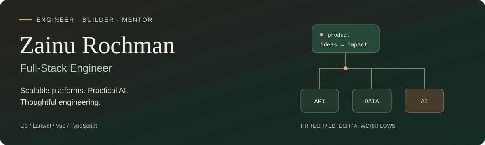

  

# Hey 👋, I'm Zainu

**Full-Stack Engineer · Bogor, Indonesia**

I build platforms that help people learn, find opportunities, and make better decisions. My work spans **HR Tech, recruitment & talent assessment, and EdTech**—from Go services and Laravel backends to Vue and TypeScript interfaces.

With **8+ years of experience**, I've built products from the ground up, led engineering squads, and worked on systems serving **2.7 million+ users**. I care about clear architecture, measurable performance, and AI that solves a real problem.

[LinkedIn](https://www.linkedin.com/in/zainu-rochman/) · [Email](mailto:rochman.ryeka@gmail.com) · [Projects](https://github.com/rochmanryeka?tab=repositories)

### ⚡ A few quick facts

- 🛠️ Built **Rencanamu** from scratch, including assessments, recommendations, APIs, and infrastructure.
- 🤖 Built **AI-assisted video interviews and CV parsing** at Talentics.
- ⚙️ Improved Talentics' **candidate-list API response time by 10×**.
- 🌱 Led squads through hands-on engineering, mentoring, and shared technical decisions.
- 🧩 Worked on **Go microservices, gRPC, group SSO, and modular backend architecture**.

### 🧰 My toolkit

  
  
  
  
  
  

| Area | Technologies |
| :--- | :--- |
| **Backend** | Go, PHP, Laravel, Node.js, REST APIs, gRPC |
| **Frontend** | JavaScript, TypeScript, Vue.js, Nuxt.js, React, Next.js, Tailwind CSS |
| **Data & search** | MySQL, PostgreSQL, MongoDB, Redis, Elasticsearch |
| **Infrastructure** | AWS · S3, EC2, SQS, SNS · Docker, Linux, Nginx, HAProxy, CI/CD |

### 🚀 Work with real-world impact

| Product | My contribution | Outcome |
| :--- | :--- | :--- |
| **Rencanamu** · EdTech | Built the platform, psychometric assessments, recommendation engine, and supporting infrastructure. | **2.7M+ users served**, **150K+ personalized report PDFs**, and **over 10× faster article pages** through caching. |
| **Talentics** · HR Tech | Built recruitment services, AI-assisted interviews, CV parsing, and Elasticsearch-powered job search; led an engineering squad. | **10× faster candidate-list API** and **5× improvement in job-search speed and relevance**. |
| **akun.mu** · Group platform | Built the Go SSO API with Google and LinkedIn login. | Unified access across **Rencanamu and Talentics**. |

### 🐾 A few things I've built

- **[Virivant](https://github.com/rochmanryeka/Virivant)** — A foreign-currency portfolio tracker with spread-aware valuations and transaction history. Built with Next.js, TypeScript, and Supabase.
- **[AICATS](https://github.com/rochmanryeka/aicats)** — A multi-agent workflow toolkit for GitHub Copilot, with specialist agents, reusable skills, and structured session memory.

<strong>Experience, in brief</strong>

 

- **Sekolah.mu Group** · December 2021 – September 2026 
  Software Engineer & Squad Lead → Senior Software Engineer & Squad Lead (January 2024).
- **Rencanamu** · April 2016 – September 2026 
  Senior Software Engineer; built the platform from scratch and continued periodic work after the December 2021 group merger.

Group work progressed from **akun.mu** (December 2021 – February 2022), to **Talentics** (March 2022 – September 2025), then **modular architecture** (October 2025 – September 2026). Rencanamu and group dates overlap after the merger; they are not separate, additive tenures.

---

**Let's build something useful.** 
For engineering conversations and collaboration, reach me on [LinkedIn](https://www.linkedin.com/in/zainu-rochman/) or [email](mailto:rochman.ryeka@gmail.com).
